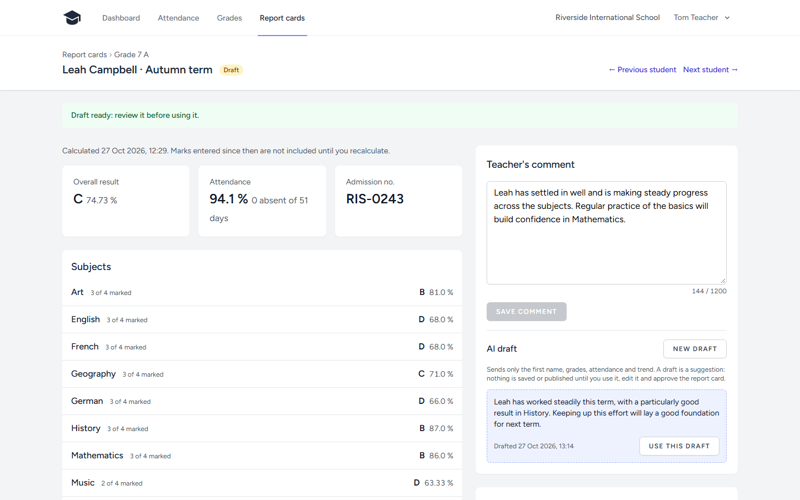
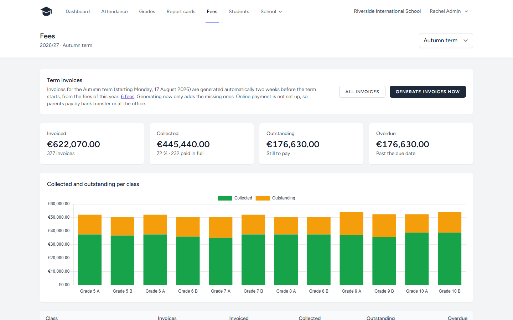
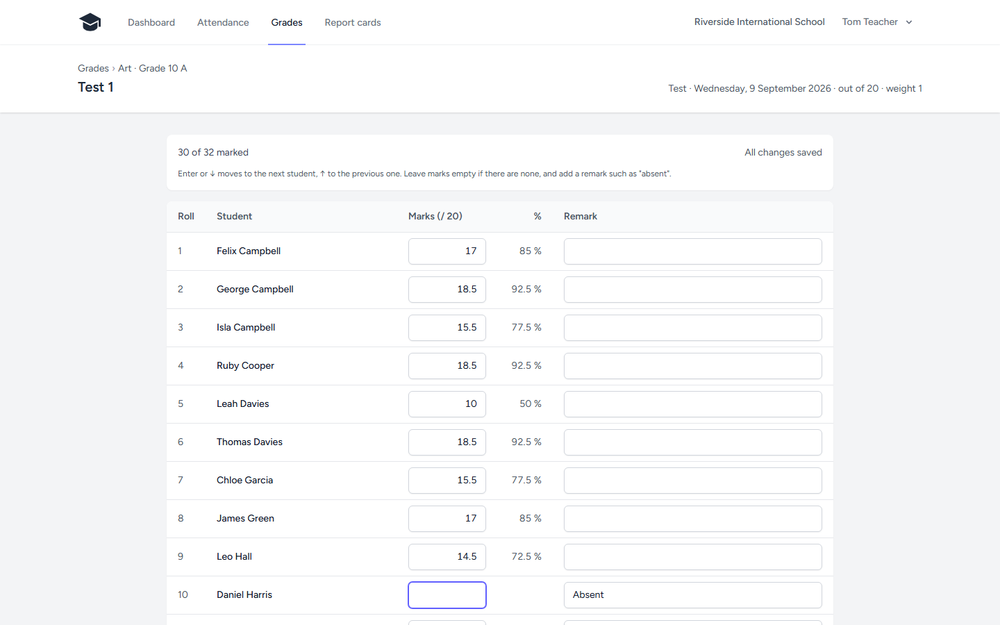
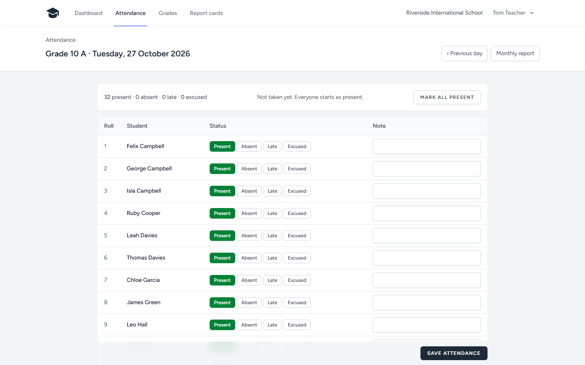
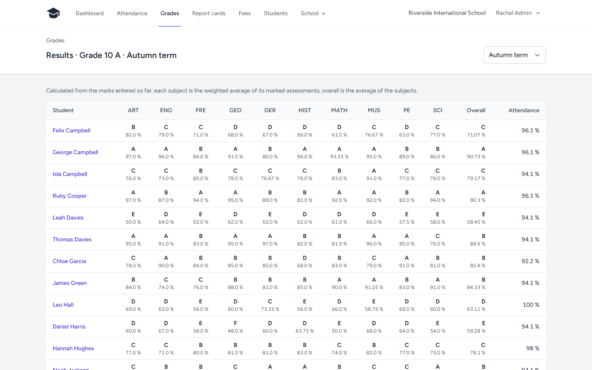
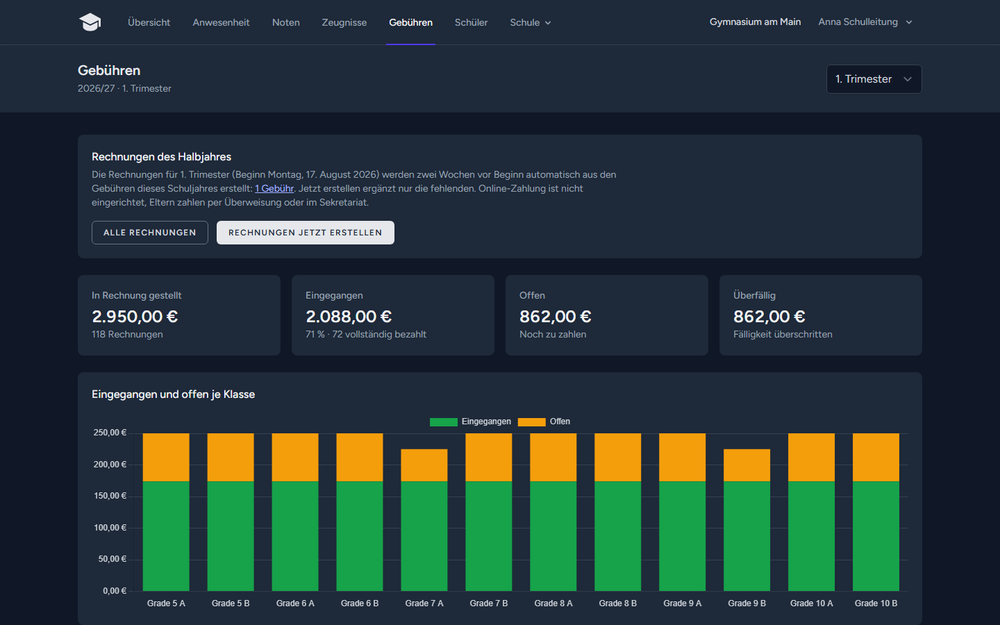
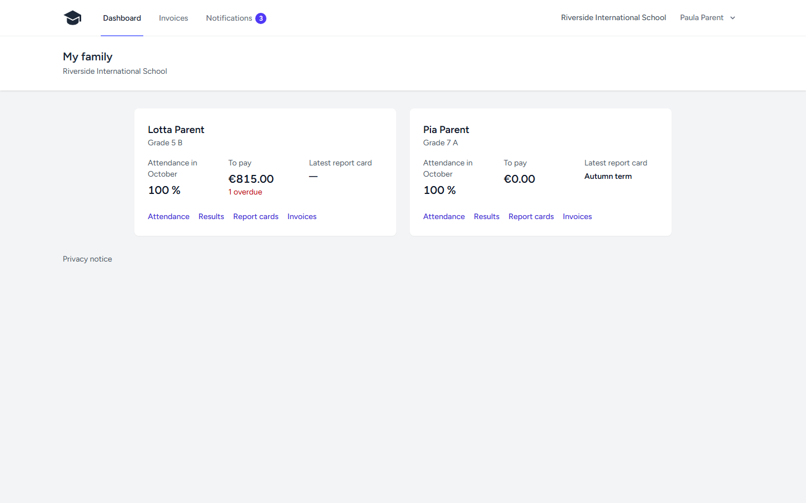
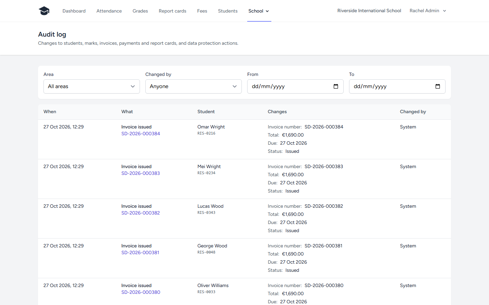
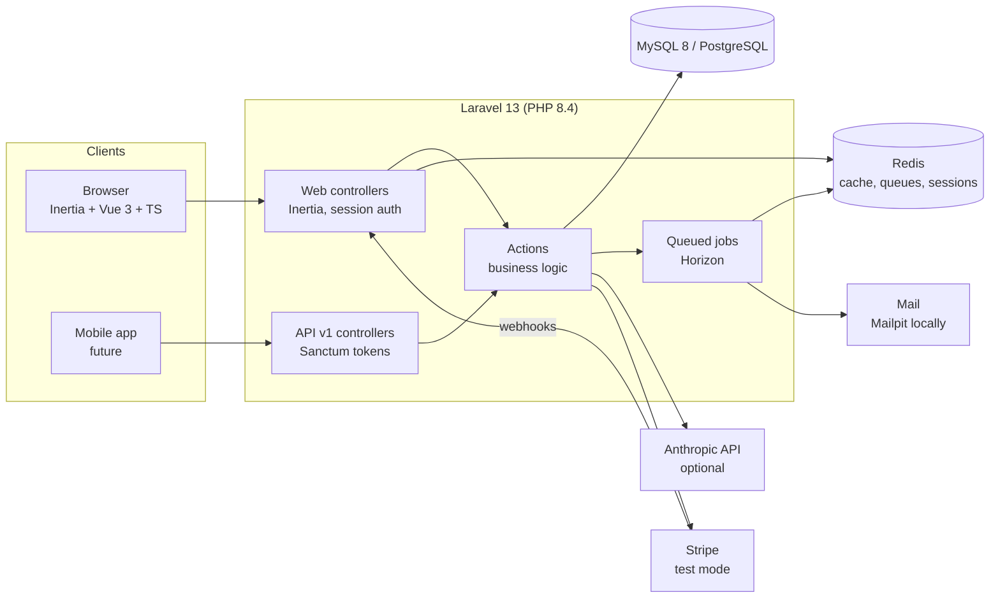

# SchoolDesk

**Multi-school management SaaS in modern Laravel: students, attendance, grades, report cards, fees and a parent portal.**

Rebuilt from a school management system the author built in PHP and ran in a real school for 9 years.

[](https://github.com/lavitsamson/schooldesk-laravel/actions/workflows/ci.yml)

Built in 12 milestones ([docs/PROGRESS.md](docs/PROGRESS.md)), with an ADR for every
non-obvious decision.

## Live demo

**Demo: _link to follow_** (resets every night). The demo seed (`migrate:fresh --seed`, also
used locally) creates these logins, all with the password `DemoPass123!`. On the demo, the
sign-in page offers them as buttons:

| Role | Email | Try |
|---|---|---|
| School admin (Riverside, EN) | `admin@riverside.demo` | Students, fees dashboard, audit log, GDPR export |
| Teacher | `teacher@riverside.demo` | Attendance grid, mark entry, report cards with AI drafts |
| Parent | `parent@riverside.demo` | Family overview, attendance calendar, report cards, paying an invoice |
| School admin (Gymnasium, DE) | `admin@gymnasium.demo` | The German UI and the German 1–6 grade scale |

## Screenshots

| | |
|---|---|
|  |  |
| **Report card** with an AI comment draft beside the teacher's comment | **Fees dashboard** per term and class |
|  |  |
| **Mark entry** that saves as you type | **Attendance** in one click per absent student |
|  |  |
| **Class results** across subjects | **German**, in dark mode |
|  |  |
| **Parent portal** | **Audit log** |

More: [student list](docs/screenshots/students.png), [monthly attendance report](docs/screenshots/attendance-report.png),
[report cards of a class](docs/screenshots/report-cards.png), [a parent's attendance calendar on a phone](docs/screenshots/parent-attendance-mobile.png),
[landing page](docs/screenshots/landing.png). They are taken from the demo seed by
`tests/e2e/screenshots.spec.ts` (`SCREENSHOTS=1`).

## Features

- **Multi-school tenancy.** One database, with strict per-school isolation that fails closed. Users can belong to several schools and switch between them.
- **Roles.** School admin, teacher and parent, scoped per school (spatie teams mode) and enforced with policies. Platform admin is a separate flag.
- **Onboarding.** Signing up creates a school. A setup wizard then covers school details, academic year and terms, classes, subjects and the grade scale (A–F or German 1–6).
- **Invitations.** Admins invite teachers, parents and other admins by email with signed links that expire. Re-sending a link invalidates the old one.
- **School structure.** Academic years with terms, classes per year (optionally copied from last year), subjects, and a subject teacher for each class.
- **Students and guardians.** A server-paginated student list with search, class and status filters, sorting, and bulk actions (move to class, mark as left, export selected to Excel). Photos are stored privately and served only to authorised users. Siblings share guardians, each student has one primary contact, and guardians can be invited to the parent portal.
- **Promotion.** At the end of the year, students move up class by class from a preview with suggested targets. Repeaters can be excluded, and the final grade graduates. Last year's enrolments stay as history.
- **Bulk import.** Students and guardians from CSV or Excel, imported in queued chunks of 200 rows with a live progress bar. Valid rows import even when others fail; failed rows come back as a downloadable error report that can be fixed and uploaded again. The admission number is the key, so re-uploading a file only updates. Files saved by German Excel (semicolons, Windows-1252, `17.05.2014`) work as they are, and "export selected" writes the same format.
- **Attendance.** Teachers pick a class and a day and get a grid where everyone starts as present, so marking takes one click per absent student. Teachers see their own classes only (class teacher or subject teacher); admins see all of them. Each new absence sends the primary guardian an email, and a notification in the parent portal if they have an account. The email is queued with a short delay, so a wrong click fixed straight away is never sent, and a guardian gets at most one per child and day. A monthly report per class shows a day-by-day grid, attendance rates and a chart, and exports to Excel.
- **Assessments and grades.** Subject teachers set tests, exams and assignments for the classes they teach, each with its own maximum marks and weight. Marks go into a spreadsheet-like grid that saves as you type: Enter moves to the next student, invalid marks are flagged in the cell, and a decimal comma works. The gradebook shows each student's weighted result so far. Class teachers and admins see a class's results across all subjects, with attendance, and what each student's report card will say. Results are calculated with exact decimals and graded with the school's scale (A–F, German 1–6, or adjusted bands, checked for gaps and overlaps).
- **Report cards.** The class teacher generates a whole class's report cards as a queued batch with a live progress bar. They write a comment per student, moving from one student to the next, and approve each card. Approval freezes the results and renders a PDF (dompdf) with the logo, grades, attendance and comment. Publishing notifies the guardians. Drafts can be recalculated when marks change, approved cards can be reopened until they are published, and PDFs are served only through signed, authorised links.
- **AI comment drafts (optional).** A school admin can turn on AI drafts for the school. "Draft comment" then suggests 2–3 sentences in the school's language, shown beside the editor. The teacher decides whether to use the draft, edits it, and approves the card. The model only gets the first name, grades, attendance and a trend word: never the surname, date of birth, address or free-text remarks. Drafts are rate limited per school, and their token usage is stored.

- **Fees and payments.** Admins set fees per year and class (every term, once a year, or one-off for new students). Two weeks before a term starts, a daily job issues every student's invoice, with gapless numbers (`SD-2026-000123`); running it again only fills gaps. Parents pay online through Stripe Checkout (test mode), and the office records cash and bank transfers, also in parts. Payments are recorded from Stripe's signed webhooks only, de-duplicated, and refunds made in Stripe flow back. Receipts are rendered as PDFs in a queued job, and the primary guardian gets the invoice, a payment confirmation and reminders 3 and 10 days after the due date. A dashboard per term shows collected, outstanding and overdue amounts per class. All money is integer cents in a `Money` value object.

- **Parent portal.** Parents land on a family overview: per child this month's attendance, what is left to pay and the latest report card. Each child has an attendance calendar, the results so far in the term, and the published report cards as PDFs, with a switcher between siblings. Invoices are paid online from the portal. Notifications (absences, report cards, invoices, payments, reminders) have an unread badge, and a parent with children at two schools sees each school's notifications only there.
- **Parent API** for a mobile app (`/api/v1`, Sanctum bearer tokens). Each token is for one device and one school, and every request acts for that school only. The endpoints are children, attendance by month, grades by term, report cards and their PDFs, invoices with Stripe Checkout, notifications and `/me`. Lists use cursor pagination, errors have one JSON shape (`message`, `code`, `errors`), and requests are rate-limited to 60 a minute. The portal and the API share the same actions, Form Requests and resources. Docs: [/docs](http://localhost/docs/) (Scribe, with OpenAPI and Postman exports).

- **English, German and Hindi.** The whole app is translated: pages, validation messages, emails, notifications, Excel exports and PDFs. Each user picks a language on their profile; otherwise the school's language applies, and guests get their browser's. Emails, queued work and report cards use the school's language unless the reader chose another, and dates and numbers follow the language ("26 October 2026", "26. Oktober 2026"). Hindi PDFs use a bundled Devanagari font. A CI check fails when a translation is missing. _The Hindi translation is machine quality and has not been reviewed by a native speaker._
- **Audit log.** Changes to students, marks, invoices, payments and report-card approvals are recorded with who made them, when, and the old and new values. GDPR exports and erasures are recorded too. School admins filter the log by area, person and date, and each student page links to that student's history.
- **GDPR.** Admins export everything held about a student (JSON plus the PDFs, in a ZIP prepared in the background, with an emailed link that expires after 24 hours). The right to erasure anonymises a student: personal fields, photos, comments, generated PDFs and the personal values in the audit log are removed, while marks and financial records stay for legal retention. Each school sets how long attendance notes are kept, and a privacy notice template is included in all three languages. Details: [docs/GDPR.md](docs/GDPR.md).

- **Security and accessibility.** A nonce-based Content Security Policy and security headers on every response, rate limits on everything that signs in, sends mail or calls an API, and no third-party requests from the browser (fonts are self-hosted). Every main page is checked with axe (WCAG 2.1 AA) in light and dark mode in CI. Details: [docs/SECURITY.md](docs/SECURITY.md), [docs/ACCESSIBILITY.md](docs/ACCESSIBILITY.md).

- **Production-ready deployment.** Multi-stage Docker images without dev dependencies, and one Compose stack for a VPS: Caddy (automatic HTTPS) → Nginx → PHP-FPM, plus Horizon, the scheduler, MySQL and Redis. A deploy script migrates with the new image before the restart and ends with a smoke test, and CI builds and runs the whole production stack on every push. A demo mode adds a banner and the demo logins, and rebuilds the demo every night. Details: [docs/DEPLOYMENT.md](docs/DEPLOYMENT.md).

## Architecture



Details: [docs/ARCHITECTURE.md](docs/ARCHITECTURE.md) (code layout, a request end to end, tenancy,
queues) and [docs/DEPLOYMENT.md](docs/DEPLOYMENT.md) (the production containers).

## Tech stack

| Area | Choice |
|---|---|
| Backend | Laravel 13, PHP 8.4, `declare(strict_types=1)` everywhere |
| Frontend | Inertia.js, Vue 3, TypeScript, Tailwind CSS 4 (Laravel Breeze), Chart.js via vue-chartjs |
| Database | MySQL 8 and PostgreSQL (CI runs on both) |
| Cache / queues / sessions | Redis, Laravel Horizon |
| Auth | Breeze (session), Sanctum (parent API) |
| API docs | Scribe (static HTML, OpenAPI, Postman) |
| Localisation | Laravel JSON translations (en, de, hi), laravel-vue-i18n |
| Audit trail | spatie/laravel-activitylog |
| PDFs | dompdf |
| Testing | Pest (feature, unit, architecture), Playwright (E2E) with axe-core for accessibility |
| Quality | Larastan level 8, Pint, ESLint, Prettier, vue-tsc |
| Local dev | Laravel Sail (MySQL, Redis, Mailpit) |
| Production | Docker Compose: Caddy, Nginx, PHP-FPM, Horizon, scheduler, MySQL, Redis |
| CI | GitHub Actions (lint, Pest on MySQL and PostgreSQL, Playwright, production stack) |

## Local setup

Requirements: Docker. PHP and Node on the host are optional.

```bash
cp .env.example .env
docker run --rm -u "$(id -u):$(id -g)" -v "$(pwd):/var/www/html" -w /var/www/html laravelsail/php84-composer:latest composer install --ignore-platform-reqs
./vendor/bin/sail up -d
./vendor/bin/sail artisan key:generate && ./vendor/bin/sail artisan migrate:fresh --seed
./vendor/bin/sail npm install && ./vendor/bin/sail npm run dev
```

The app runs at <http://localhost>. Mailpit runs at <http://localhost:8025>.

To run the **production stack** instead (or deploy it to a VPS), see [docs/DEPLOYMENT.md](docs/DEPLOYMENT.md).

Invitation emails, absence emails, student imports, report-card batches, payment receipts and
fee emails are queued. Run the
workers with `./vendor/bin/sail artisan horizon`. Horizon has a separate supervisor for long jobs
(the `imports` and `reports` queues), so a large import never delays emails.

**AI comment drafts** need no setup for the demo. Without `ANTHROPIC_API_KEY` in `.env`, a
built-in fake (`FakeLlmClient`) writes a simple draft from the same data, and nothing leaves the
server. To use Claude, set `ANTHROPIC_API_KEY` (and optionally `ANTHROPIC_MODEL`, which defaults
to `claude-opus-5-5`). Riverside has AI drafts turned on in the seed. Other schools turn them on
under Report cards.

Horizon's dashboard is at <http://localhost/horizon> (open to everyone locally, platform admins
only elsewhere). The scheduler (`./vendor/bin/sail artisan schedule:work`) generates term invoices
at night and sends payment reminders in the morning.

**Online payments (Stripe, test mode)** are optional. Without `STRIPE_SECRET`, parents see no pay
button and admins record cash and bank payments. To try Checkout, put your Stripe **test** keys in
`.env` and forward the webhooks with the Stripe CLI:

```bash
stripe listen --forward-to localhost/webhooks/stripe   # prints the whsec_… for STRIPE_WEBHOOK_SECRET
```

Then log in as `parent@riverside.demo`, open Lotta's invoice and pay with the test card
`4242 4242 4242 4242`. The payment shows once Stripe's webhook arrives.

**Parent API.** The docs are at <http://localhost/docs/> (also as `openapi.yaml` and a Postman
collection in `public/docs`). Try it with the demo parent:

```bash
curl -X POST localhost/api/v1/auth/token -H 'Accept: application/json' \
  -d email=parent@riverside.demo -d password=DemoPass123! -d device_name=curl
curl localhost/api/v1/children -H 'Accept: application/json' -H 'Authorization: Bearer <token>'
```

The docs are generated from the routes, Form Requests and the `@response` examples in the API
controllers. After changing an endpoint, run `./vendor/bin/sail artisan scribe:generate` and commit
`public/docs`.

> **Windows:** keep the project inside the WSL2 filesystem (e.g. `~/code/schooldesk`). Serving it
> from a Windows-mounted folder (`/mnt/c/...`) makes every request take several seconds.
>
> Tip: add `alias sail='sh $([ -f sail ] && echo sail || echo vendor/bin/sail)'` to your shell profile.

## Testing and quality

```bash
./vendor/bin/sail artisan test           # Pest: feature, unit and architecture tests
./vendor/bin/sail pint                   # code style (add --test to check only)
./vendor/bin/sail php vendor/bin/phpstan analyse   # Larastan level 8
./vendor/bin/sail npm run lint           # ESLint
./vendor/bin/sail npm run typecheck      # vue-tsc
E2E_BASE_URL=http://localhost npx playwright test   # Playwright against the running app
```

On a slow mount (Sail on a Windows folder), running Pest with the CLI opcache enabled is many
times faster: `./vendor/bin/sail php -d opcache.enable_cli=1 vendor/bin/pest`.

The E2E tests expect the demo seed (`migrate:fresh --seed`). If the local app is slow (Sail on a
Windows-mounted folder), set `E2E_EXPECT_TIMEOUT=90000` and run with `--workers=1`: Sail's dev
server handles one request at a time. Without `E2E_BASE_URL`, Playwright starts
`php artisan serve` itself, which is what CI does. The fees and journey specs simulate Stripe by
posting a signed webhook: give the app a test `STRIPE_WEBHOOK_SECRET` and Playwright the same
value in `E2E_STRIPE_WEBHOOK_SECRET` (those specs are skipped without it).

- `journey.spec.ts` runs a new school end to end: registration and email verification, the setup
  wizard, a teacher invited by email, a student imported with a guardian, invoices, attendance,
  marks, an approved and published report card, and the parent reading it and paying. It follows
  the emailed links through Mailpit's API (`E2E_MAILPIT_URL`, default `http://127.0.0.1:8025`),
  so `APP_URL` must be the address Playwright uses, and the queue must run.
- `pages.spec.ts` opens every main page per role in light and dark mode and fails on any axe
  (WCAG 2.1 AA) or Content Security Policy violation.

## Performance

`./vendor/bin/sail artisan db:seed --class=PerformanceSeeder` (after the demo seed, about 10–30
minutes) adds 20 schools with **10,080 students, 4.3 million attendance records** (every school
day of the last two years), **1.5 million marks** and 40,000 invoices. Then:

```bash
./vendor/bin/sail bash scripts/benchmark.sh   # needs Horizon running for the report-card batch
```

The script copies the app to the container's own file system and serves it like a deployment
(optimised autoloader, cached config and routes, opcache, no debug): on a Windows or macOS bind
mount, every request would spend about 85 ms just reading the framework's files. It signs in as a
school admin and requests each page 30 times the way the app navigates (Inertia JSON requests).

| Page (school of 504 students) | Target | Before (p50 / p95) | After (p50 / p95) |
|---|---|---|---|
| Student list | < 200 ms | 56 / 67 ms | 56 / 70 ms |
| Student list, search | | 53 / 60 ms | 54 / 64 ms |
| Student list, sorted by class | | 62 / 70 ms | 62 / 69 ms |
| Attendance grid (class of 42) | < 150 ms | 61 / 71 ms | 63 / 71 ms |
| Attendance month report | | **196 / 238 ms** | **64 / 73 ms** |
| Class results (all subjects) | | **384 / 420 ms** | **137 / 154 ms** |
| Fees dashboard | | 52 / 60 ms | 55 / 63 ms |
| Invoice list | | 70 / 86 ms | 66 / 73 ms |
| Report cards for a class of 42 (queued batch) | < 60 s | 3.6–5.9 s | 3.6–5.9 s |

Measured back to back in Sail on a laptop (Windows 11, WSL2). The targets were met before any
tuning, thanks to composite indexes that start with `school_id` and eager loading. The two slow
pages hydrated thousands of models and cast the same dates and decimals again and again; they now
read plain rows. Grade scales are cached per school. Details in ADR 0011.

**Tenant isolation.** [`tests/Support/CrossSchoolRoutes.php`](tests/Support/CrossSchoolRoutes.php)
lists, for every route with a parameter, a request for another school's record. Each must return 404.
A guard test fails when a new route is neither listed nor explicitly exempted. The parent API has
its own list: a parent with a token for School A gets 404 for School B's records. A second guard
checks that every model with a `school_id` column uses `BelongsToSchool`.

**Translations.** `./vendor/bin/sail npm run i18n:check` fails when a key used in the code is
missing from `lang/de.json` or `lang/hi.json`, or when a language file has unused keys. A Pest
test checks that translations keep their placeholders.

Pest runs against a real database (the `testing` database Sail creates), not SQLite, so behaviour
matches production. CI runs the suite on both **MySQL 8.4** and **PostgreSQL 17**.

## Design decisions

| ADR | Summary |
|---|---|
| [0001 — Multi-tenancy](docs/adr/0001-multi-tenancy.md) | Shared database with `school_id` and a fail-closed `BelongsToSchool` global scope, instead of database-per-tenant. Simple to run on one VPS and works on MySQL and PostgreSQL. Isolation is proven by a cross-school 404 test suite. |
| [0002 — Roles and permissions](docs/adr/0002-roles-and-permissions.md) | spatie/laravel-permission in teams mode, with the team id read from `CurrentSchool` so role checks can never target a different school than the data scope. Roles and permissions are enums, synced by a migration. |
| [0003 — Enrolments and promotion](docs/adr/0003-enrolments-and-promotion.md) | A student's class is an enrolment per academic year, not a column on the student, so attendance and grades keep their class after students move up. Promotion creates next year's enrolments from a reviewed preview, and running it twice is harmless. |
| [0004 — Student import](docs/adr/0004-student-import.md) | Queued chunks on their own queue, row-level validation, and a per-row outcome table that drives progress, cross-chunk duplicate checks and the error report. The admission number is the key, so re-uploads are idempotent. Uploads are deleted after the import and reports pruned after 30 days. |
| [0005 — Attendance](docs/adr/0005-attendance.md) | One record per student and day, keeping the class it was taken in. The whole grid is saved in one transaction. Absence emails are delayed a few minutes, and the job claims the record under a row lock before it sends, so a guardian gets at most one per child and day. "Today" means today in the school's timezone. |
| [0006 — Assessments and grade calculation](docs/adr/0006-assessments-and-grade-calculation.md) | A subject's result is the weighted mean of its marked assessments (missing marks are left out, not counted as zero), and overall is the mean of the rounded subject results. All arithmetic uses exact decimals (bcmath), so boundary cases always land in the same band. The mark grid autosaves changed rows as JSON. |
| [0007 — Report cards and AI comment drafts](docs/adr/0007-report-cards-and-ai-comment-drafts.md) | A report card stores the calculated snapshot, and approval freezes it and renders the PDF, so parents always read what was signed off. Class generation is a Laravel job batch with one job per student. AI drafts are off by default, sit beside the comment instead of in it, and get only a minimised, test-enforced payload. |
| [0008 — Fees, invoices and Stripe payments](docs/adr/0008-fees-invoices-and-stripe-payments.md) | Money is integer cents. Term invoices are generated idempotently (unique per student and term, a lock per run) with gapless numbers from a locked counter. Card payments exist only once Stripe's signed webhook confirms them; the event id is claimed in the same transaction as the payment, so duplicates do nothing and failures retry. What is paid is derived from payments, never stored twice. |
| [0009 — Parent portal and API](docs/adr/0009-parent-portal-and-api.md) | One Sanctum token per device and school. `SetCurrentSchool` reads the school from the token, as it reads it from the session on the web, and checks the membership on every request. Notifications store their school. The portal and the API share actions, Form Requests and resources. API errors have one shape, lists use cursor pagination, and the docs are generated by Scribe as static files. |
| [0010 — Localisation](docs/adr/0010-localisation.md) | English text is the translation key, shared by PHP and Vue, and a CI check keeps German and Hindi complete. The language is the user's, else the school's, else the browser's. Queued work and PDFs use the school's language, and notifications are translated when read. Hindi PDFs use a bundled font; dompdf's lack of Devanagari shaping is a known limit. |
| [0011 — Performance and hardening](docs/adr/0011-performance-and-hardening.md) | Measure on a production-like copy before optimising: the targets were already met, and only two pages needed plain rows instead of models. Grade scales are cached per school and dropped after the change commits; school settings are not, because they come with the membership check. A nonce-based CSP with narrow, documented exceptions, typed spreadsheet exports, and browser checks (axe, CSP) for every page in CI. |
| [0012 — Production deployment and demo](docs/adr/0012-production-deployment-and-demo.md) | One multi-stage Dockerfile builds an `app` image (PHP-FPM, also running Horizon and the scheduler) and a `web` image (Nginx). Caddy in front gets certificates by itself; Laravel trusts forwarded headers from the Docker network only. Deploys are a script that migrates with the new image first and ends with a smoke test, which CI also runs against the production stack. The demo resets nightly in maintenance mode and signs everyone out, because new sign-ups reuse yesterday's user ids. |

## Security and GDPR

GDPR: [docs/GDPR.md](docs/GDPR.md) covers the personal data held, data export, erasure by
anonymisation, retention and data minimisation in the AI feature. Security:
[docs/SECURITY.md](docs/SECURITY.md) lists the threats considered (cross-school leakage, IDOR,
invitation abuse, webhook spoofing, file access, prompt injection, XSS, spreadsheet formula
injection, authentication attacks, spoofed proxy headers, the public demo), each mitigation and its
tests, and the findings of the milestone 11 review. Accessibility: [docs/ACCESSIBILITY.md](docs/ACCESSIBILITY.md).

## How I used AI

See [docs/AI_USAGE.md](docs/AI_USAGE.md).

## Author

**Lavit Samson**, Senior Full-Stack Engineer. [linkedin.com/in/lavit-samson](https://linkedin.com/in/lavit-samson)
