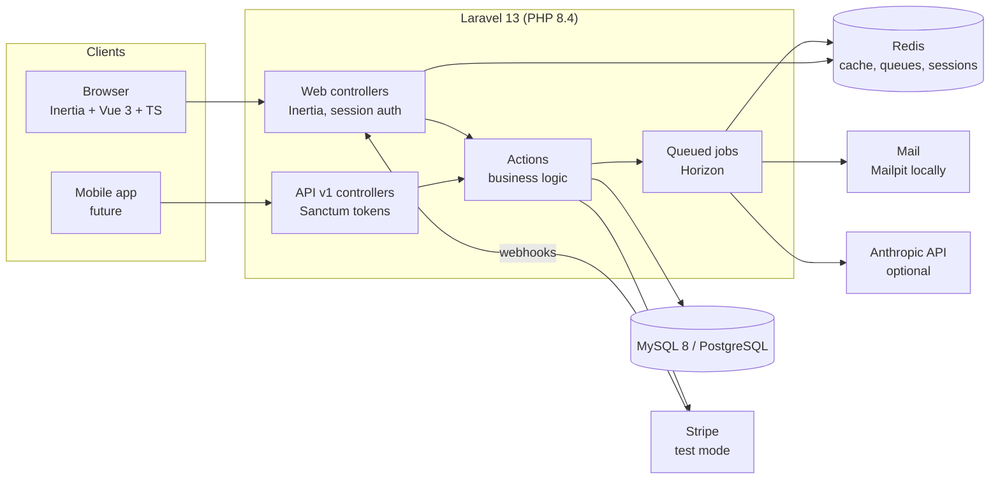

# SchoolDesk

**Multi-school management SaaS in modern Laravel: students, attendance, grades, report cards, fees and a parent portal.**

Rebuilt from a school management system the author built in PHP and ran in a real school for 9 years.

[](https://github.com/lavitsamson/schooldesk-laravel/actions/workflows/ci.yml)

> 🚧 **Work in progress.** Built milestone by milestone. See [docs/PROGRESS.md](docs/PROGRESS.md).

## Live demo

Coming with the release milestone. Locally, `migrate:fresh --seed` creates these logins
(password `DemoPass123!`):

| Role | Email |
|---|---|
| School admin (Riverside, EN) | `admin@riverside.demo` |
| Teacher | `teacher@riverside.demo` |
| Parent | `parent@riverside.demo` |
| School admin (Gymnasium, DE) | `admin@gymnasium.demo` |

## Screenshots

_Coming soon._

## Features

Available now:

- **Multi-school tenancy.** One database, with strict per-school isolation that fails closed. Users can belong to several schools and switch between them.
- **Roles.** School admin, teacher and parent, scoped per school (spatie teams mode) and enforced with policies. Platform admin is a separate flag.
- **Onboarding.** Signing up creates a school. A setup wizard then covers school details, academic year and terms, classes, subjects and the grade scale (A–F or German 1–6).
- **Invitations.** Admins invite teachers, parents and other admins by email with signed links that expire. Re-sending a link invalidates the old one.
- **School structure.** Academic years with terms, classes per year (optionally copied from last year), subjects, and a subject teacher for each class.
- **Students and guardians.** A server-paginated student list with search, class and status filters, sorting, and bulk actions (move to class, mark as left, export selected to Excel). Photos are stored privately and served only to authorised users. Siblings share guardians, each student has one primary contact, and guardians can be invited to the parent portal.
- **Promotion.** At the end of the year, students move up class by class from a preview with suggested targets. Repeaters can be excluded, and the final grade graduates. Last year's enrolments stay as history.
- **Bulk import.** Students and guardians from CSV or Excel, imported in queued chunks of 200 rows with a live progress bar. Valid rows import even when others fail; failed rows come back as a downloadable error report that can be fixed and uploaded again. The admission number is the key, so re-uploading a file only updates. Files saved by German Excel (semicolons, Windows-1252, `17.05.2014`) work as they are, and "export selected" writes the same format.
- **Attendance.** Teachers pick a class and a day and get a grid where everyone starts as present, so marking takes one click per absent student. Teachers see their own classes only (class teacher or subject teacher); admins see all of them. Each new absence sends the primary guardian an email, and a notification in the parent portal if they have an account. The email is queued with a short delay, so a wrong click fixed straight away is never sent, and a guardian gets at most one per child and day. A monthly report per class shows a day-by-day grid, attendance rates and a chart, and exports to Excel.

Planned for v1:
- **Assessments and grades.** A spreadsheet-like grade entry grid, with A–F or German 1–6 grade scales.
- **Report cards.** Batch generation, PDFs, an approval flow, and optional AI-drafted comments with data minimisation.
- **Fees.** Scheduled term invoices, Stripe Checkout (test mode), webhooks and receipts.
- **Parent portal and REST API** (Sanctum) for a future mobile app.
- **GDPR.** Data export, right to erasure (anonymisation) and retention settings.
- **Fully bilingual** in English and German.

## Architecture



Details: [docs/ARCHITECTURE.md](docs/ARCHITECTURE.md) _(coming soon)_.

## Tech stack

| Area | Choice |
|---|---|
| Backend | Laravel 13, PHP 8.4, `declare(strict_types=1)` everywhere |
| Frontend | Inertia.js, Vue 3, TypeScript, Tailwind CSS 4 (Laravel Breeze), Chart.js via vue-chartjs |
| Database | MySQL 8 and PostgreSQL (CI runs on both) |
| Cache / queues / sessions | Redis, Laravel Horizon |
| Auth | Breeze (session), Sanctum (parent API) |
| Testing | Pest (feature, unit, architecture), Playwright (E2E) |
| Quality | Larastan level 8, Pint, ESLint, Prettier, vue-tsc |
| Local dev | Laravel Sail (MySQL, Redis, Mailpit) |
| CI | GitHub Actions |

## Local setup

Requirements: Docker. PHP and Node on the host are optional.

```bash
cp .env.example .env
docker run --rm -u "$(id -u):$(id -g)" -v "$(pwd):/var/www/html" -w /var/www/html laravelsail/php84-composer:latest composer install --ignore-platform-reqs
./vendor/bin/sail up -d
./vendor/bin/sail artisan key:generate && ./vendor/bin/sail artisan migrate:fresh --seed
./vendor/bin/sail npm install && ./vendor/bin/sail npm run dev
```

The app runs at <http://localhost>. Mailpit runs at <http://localhost:8025>.

Invitation emails, absence emails and student imports are queued. Run the workers with
`./vendor/bin/sail artisan horizon`. Horizon has a separate supervisor for the `imports` queue,
so a large import never delays emails. Its dashboard is at <http://localhost/horizon> (open to
everyone locally, platform admins only elsewhere).

> **Windows:** keep the project inside the WSL2 filesystem (e.g. `~/code/schooldesk`). Serving it
> from a Windows-mounted folder (`/mnt/c/...`) makes every request take several seconds.
>
> Tip: add `alias sail='sh $([ -f sail ] && echo sail || echo vendor/bin/sail)'` to your shell profile.

## Testing and quality

```bash
./vendor/bin/sail artisan test           # Pest: feature, unit and architecture tests
./vendor/bin/sail pint                   # code style (add --test to check only)
./vendor/bin/sail php vendor/bin/phpstan analyse   # Larastan level 8
./vendor/bin/sail npm run lint           # ESLint
./vendor/bin/sail npm run typecheck      # vue-tsc
E2E_BASE_URL=http://localhost npx playwright test   # Playwright against the running app
```

On a slow mount (Sail on a Windows folder), running Pest with the CLI opcache enabled is many
times faster: `./vendor/bin/sail php -d opcache.enable_cli=1 vendor/bin/pest`.

The E2E tests expect the demo seed (`migrate:fresh --seed`). If the local app is slow (Sail on a
Windows-mounted folder), set `E2E_EXPECT_TIMEOUT=90000` and run with `--workers=1`: Sail's dev
server handles one request at a time. Without `E2E_BASE_URL`, Playwright starts
`php artisan serve` itself, which is what CI does.

**Tenant isolation.** [`tests/Support/CrossSchoolRoutes.php`](tests/Support/CrossSchoolRoutes.php)
lists, for every route with a parameter, a request for another school's record. Each must return 404.
A guard test fails when a new route is neither listed nor explicitly exempted. A second guard
checks that every model with a `school_id` column uses `BelongsToSchool`.

Pest runs against a real database (the `testing` database Sail creates), not SQLite, so behaviour
matches production. CI runs the suite on both **MySQL 8.4** and **PostgreSQL 17**.

## Design decisions

| ADR | Summary |
|---|---|
| [0001 — Multi-tenancy](docs/adr/0001-multi-tenancy.md) | Shared database with `school_id` and a fail-closed `BelongsToSchool` global scope, instead of database-per-tenant. Simple to run on one VPS and works on MySQL and PostgreSQL. Isolation is proven by a cross-school 404 test suite. |
| [0002 — Roles and permissions](docs/adr/0002-roles-and-permissions.md) | spatie/laravel-permission in teams mode, with the team id read from `CurrentSchool` so role checks can never target a different school than the data scope. Roles and permissions are enums, synced by a migration. |
| [0003 — Enrolments and promotion](docs/adr/0003-enrolments-and-promotion.md) | A student's class is an enrolment per academic year, not a column on the student, so attendance and grades keep their class after students move up. Promotion creates next year's enrolments from a reviewed preview, and running it twice is harmless. |
| [0004 — Student import](docs/adr/0004-student-import.md) | Queued chunks on their own queue, row-level validation, and a per-row outcome table that drives progress, cross-chunk duplicate checks and the error report. The admission number is the key, so re-uploads are idempotent. Uploads are deleted after the import and reports pruned after 30 days. |
| [0005 — Attendance](docs/adr/0005-attendance.md) | One record per student and day, keeping the class it was taken in. The whole grid is saved in one transaction. Absence emails are delayed a few minutes, and the job claims the record under a row lock before it sends, so a guardian gets at most one per child and day. "Today" means today in the school's timezone. |

## Security and GDPR

See [docs/SECURITY.md](docs/SECURITY.md) and [docs/GDPR.md](docs/GDPR.md) _(coming in later milestones)_.

## How I used AI

See [docs/AI_USAGE.md](docs/AI_USAGE.md).

## Author

**Lavit Samson**, Senior Full-Stack Engineer. [linkedin.com/in/lavit-samson](https://linkedin.com/in/lavit-samson)
