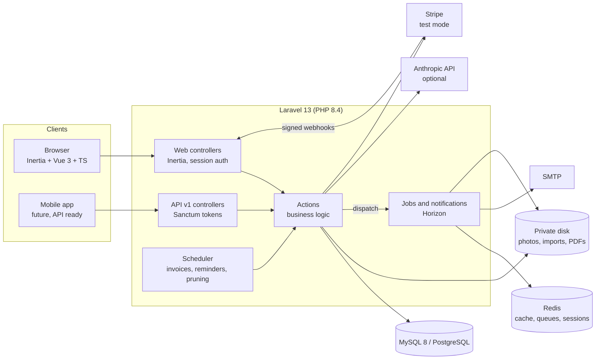
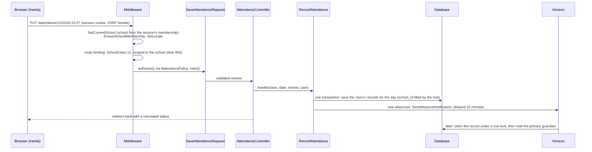

# Architecture

SchoolDesk is one Laravel 13 application with an Inertia + Vue 3 frontend, a Sanctum-protected
parent API, and queued work in Horizon. It is a modular monolith in plain Laravel conventions:
no custom framework layer, with business logic in single-purpose Action classes.

## System

In production every box inside Laravel is a container from the same image (PHP-FPM, Horizon,
scheduler) behind Nginx and Caddy: see [DEPLOYMENT.md](DEPLOYMENT.md).

## Code layout

| Directory | Contents |
|---|---|
| `app/Actions/<Area>/` | ~100 single-purpose classes with one `handle()` method: `RecordAttendance`, `CalculateReportCard`, `GenerateTermInvoices`, `AnonymiseStudent` ... The only place business rules live. Final, tested directly. |
| `app/Http/Controllers/Web/` | Inertia controllers: resolve input through a Form Request, call one action, return a page or redirect |
| `app/Http/Controllers/Api/V1/` | The parent API: same actions, Form Requests and resources as the parent portal |
| `app/Http/Requests/` | Form Requests: validation and `authorize()` for every input |
| `app/Http/Resources/` | API Resources: explicit output shapes, shared by the portal and the API |
| `app/Policies/` | One per model: who may see or change what, per role and per assignment |
| `app/Models/` + `Concerns/` | Eloquent models; school-owned ones use `BelongsToSchool` |
| `app/Jobs/`, `app/Notifications/` | Queued work: report-card generation, receipts, exports, guardian notifications |
| `app/Imports/`, `app/Exports/` | Laravel Excel: chunked student import, spreadsheet exports |
| `app/Services/` | Wrappers of external services: `StripeService`, `Llm/LlmClient` (Anthropic or fake) |
| `app/Support/` | Value objects and helpers: `CurrentSchool`, `Money`, `Grading/Decimal`, `LocalDate`, `SchoolRule` |
| `app/Enums/` | Backed enums for roles, permissions, statuses and types, with translated labels |
| `resources/js/Pages/` | Vue pages, one per Inertia response; `Components/`, `Layouts/`, `composables/` |
| `lang/` | `de.json`, `hi.json` (English text is the key) and framework group files |

Pest architecture tests (`tests/Unit/ArchitectureTest.php`) enforce the conventions: strict
types everywhere, actions final with `handle()`, backed enums, no debugging helpers, Laravel's
security preset.

## A request, end to end

Saving the attendance grid (`PUT /attendance/{class}/{date}`):

## Multi-tenancy

One database; every school-owned row has `school_id`, the first column of its composite
indexes ([ADR 0001](adr/0001-multi-tenancy.md)).

- `CurrentSchool` holds the request's school. `SetCurrentSchool` takes it from the user's
  selected membership (web) or from the Sanctum token (API), never from input, and checks the
  membership on every request. It runs before route binding and rate limiting.
- `BelongsToSchool` adds a global scope (`where school_id = current`) and fills `school_id` on
  create. Without a school context it throws instead of returning everything (fail closed).
- Validation rules that look up records use `SchoolRule`, because Laravel's `exists`/`unique`
  ignore global scopes.
- Queued jobs carry `schoolId` and set the context (and the school's language) in `handle()`.
- spatie/laravel-permission runs in teams mode with the current school as the team
  ([ADR 0002](adr/0002-roles-and-permissions.md)).
- `tests/Support/CrossSchoolRoutes.php` requests another school's record on every route with a
  parameter and expects 404; a guard test fails when a new route is missing from the list.

## Data that must not drift

- **Money** is integer minor units in a `Money` value object; amounts paid are derived from
  payments, never stored twice ([ADR 0008](adr/0008-fees-invoices-and-stripe-payments.md)).
- **Grades** are calculated with exact decimals (bcmath) and graded with the school's scale; a
  report card stores the calculated snapshot, and approval freezes it and renders the PDF
  ([ADR 0006](adr/0006-assessments-and-grade-calculation.md), [ADR 0007](adr/0007-report-cards-and-ai-comment-drafts.md)).
- **Idempotency** where retries happen: Stripe events are claimed in the payment's
  transaction, term invoices are unique per student and term, imports are keyed by admission
  number, absence mails are claimed under a row lock.

## Asynchronous work

Redis queues, run by Horizon with two supervisors: `default` (mail, notifications, receipts)
and `imports` + `reports` (long jobs: student imports in chunks of 200 rows, report-card
batches as Laravel job batches), so a large import never delays an email
([ADR 0004](adr/0004-student-import.md)). The scheduler generates term invoices, sends payment
reminders, prunes old imports, exports, API tokens and attendance notes, and resets the
public demo at night ([ADR 0012](adr/0012-production-deployment-and-demo.md)).

## Frontend

Inertia renders Vue 3 pages from controller responses, so there is no separate client-side
router or API for the web app. Shared props carry the user, the current school with its roles
and permissions, the language and the unread-notification count; pages receive explicit
arrays or API Resources, never whole models. Translations are the English text as key, shared
by PHP and Vue ([ADR 0010](adr/0010-localisation.md)). The mark-entry grid autosaves with
`fetch`, the only non-Inertia request. A nonce-based CSP covers every page
([ADR 0011](adr/0011-performance-and-hardening.md)).

## External services

Both are optional and behind interfaces, so the app and its tests run without accounts:

- **Stripe** (test mode): `StripeService` creates Checkout sessions. Payments are recorded only
  from signed webhooks (`routes/webhooks.php`, outside the web middleware).
- **Anthropic** (AI comment drafts): `LlmClient` with `AnthropicLlmClient` (Laravel HTTP
  client) or `FakeLlmClient` when no key is set. The payload is minimised and asserted in tests
  ([ADR 0007](adr/0007-report-cards-and-ai-comment-drafts.md)).

## Testing

| Layer | Tool | What |
|---|---|---|
| Unit | Pest | Report-card calculation, grade-scale boundaries, Money, import row validation, architecture rules, translations' placeholders |
| Feature | Pest on MySQL and PostgreSQL | Every route: authorised, forbidden (403), other school (404), validation; webhooks; imports with fixture files; GDPR; demo reset |
| End to end | Playwright | Per-area specs, the full journey of a new school through Mailpit, axe and CSP checks of every page |
| Deployment | CI + `scripts/smoke-test.sh` | Builds the production images, starts the stack, migrates, seeds, smoke-tests, resets the demo |
