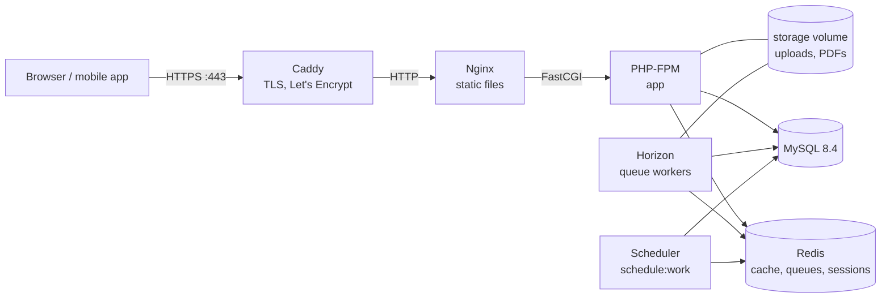

# Deployment

SchoolDesk runs on a single VPS with Docker Compose: Caddy (HTTPS) → Nginx → PHP-FPM, plus Horizon,
the scheduler, MySQL and Redis. The reasons are in [ADR 0012](adr/0012-production-deployment-and-demo.md).



| File | What it is |
|---|---|
| `docker/Dockerfile` | Multi-stage build: `app` (PHP-FPM 8.4, also runs Horizon and the scheduler) and `web` (Nginx with `public/`) |
| `docker/php/` | Production `php.ini`, PHP-FPM pool, entrypoint (caches config, routes, views and events on start) |
| `docker/nginx/default.conf` | Static files, long caching of built assets, everything else to PHP-FPM |
| `docker/caddy/Caddyfile` | HTTPS for `SITE_ADDRESS`, proxy to Nginx |
| `compose.prod.yaml` | The stack; only Caddy publishes ports |
| `.env.production.example` | Every production setting, with comments |
| `scripts/deploy.sh` | Pull, build, migrate, restart, smoke test |
| `scripts/smoke-test.sh` | Checks a running deployment (also run by CI) |

## Requirements

- A VPS with 2 vCPUs and 4 GB RAM (the demo stack uses about 1 GB at rest, most of it MySQL
  and Horizon's workers), Ubuntu 24.04 or any Linux with
  Docker Engine 27+ and the Compose plugin.
- A DNS `A` (and `AAAA`) record for your host name pointing at the server.
- Ports 80 and 443 open (Caddy needs 80 for the Let's Encrypt challenge and the redirect).
- An SMTP account for outgoing mail (or `MAIL_MAILER=log` on a demo).

## First deploy

1. **Prepare the server** (as root, once):

   ```bash
   curl -fsSL https://get.docker.com | sh
   adduser --disabled-password deploy && usermod -aG docker deploy
   ufw allow OpenSSH && ufw allow 80 && ufw allow 443/tcp && ufw allow 443/udp && ufw enable
   ```

2. **Check out the code** (as `deploy`):

   ```bash
   git clone https://github.com/lavitsamson/schooldesk-laravel.git ~/schooldesk
   cd ~/schooldesk
   cp .env.production.example .env.production && chmod 600 .env.production
   ```

3. **Configure** `.env.production`. At least:

   | Setting | Value |
   |---|---|
   | `SITE_ADDRESS`, `APP_URL` | Your host name, and `https://` plus the host name |
   | `ACME_EMAIL` | Let's Encrypt's expiry notices go here |
   | `APP_KEY` | `echo "base64:$(openssl rand -base64 32)"` |
   | `DB_PASSWORD`, `DB_ROOT_PASSWORD`, `REDIS_PASSWORD` | Long random values (`openssl rand -hex 24`) |
   | `MAIL_*` | Your SMTP provider |
   | `DEMO_MODE` | `true` only for the public demo (see below) |

   Optional: `ANTHROPIC_API_KEY` for AI comment drafts (a built-in fake writes them without it),
   `STRIPE_SECRET` and `STRIPE_WEBHOOK_SECRET` for online payments in Stripe test mode.

4. **Deploy:**

   ```bash
   scripts/deploy.sh --seed   # with the demo data
   scripts/deploy.sh          # or empty: the first visitor registers a school at /register
   ```

   The first build takes a few minutes. The script ends with the smoke test.

5. **Platform admin** (opens the Horizon dashboard at `/horizon`):

   ```bash
   docker compose -f compose.prod.yaml --env-file .env.production exec app \
     php artisan tinker --execute="App\Models\User::where('email', 'you@example.com')->update(['is_platform_admin' => true]);"
   ```

6. **Stripe** (optional): add a webhook endpoint `https://<host>/webhooks/stripe` in the Stripe
   dashboard (test mode) for `checkout.session.completed`, `payment_intent.payment_failed` and
   `charge.refunded`, and put its signing secret in `STRIPE_WEBHOOK_SECRET`.

## Updates and rollbacks

```bash
cd ~/schooldesk && scripts/deploy.sh
```

The script pulls the branch, builds images tagged with the commit (`schooldesk-app:<sha>`),
starts MySQL and Redis, runs the migrations with the new image while the old containers keep
serving, replaces the containers (Horizon finishes running jobs first), and runs the smoke test.
Requests fail for a few seconds while the containers restart.

Migrations run before the old code stops, so each release's migrations must work with the
previous release's code: add a column in one release, use it, and remove the old one in a
later release.

To roll back to an earlier image, without reverting migrations:

```bash
docker image ls schooldesk-app          # tags are commit hashes
IMAGE_TAG=<sha> docker compose -f compose.prod.yaml --env-file .env.production up -d --no-build
```

## The public demo

With `DEMO_MODE=true`:

- every page shows a banner, and the sign-in page lists the demo accounts;
- `demo:reset` runs every night at `DEMO_RESET_AT` (UTC, default 04:00). It puts the app in
  maintenance mode, clears the queues, deletes stored files, runs `migrate:fresh --seed`, and
  signs everyone out. It takes about a minute;
- set `MAIL_MAILER=log`, so the sign-up and invitation forms cannot send email to strangers.
  New sign-ups then never receive their verification email; visitors use the demo accounts.

Reset by hand: `docker compose -f compose.prod.yaml --env-file .env.production exec scheduler php artisan demo:reset`.
The command refuses to run without `DEMO_MODE=true`.

## Backups

The state is the MySQL database and the `storage-app` volume (photos, imports, PDFs, exports).
Redis holds only the cache, queues and sessions.

```bash
# ~/backup.sh, run daily from cron: 30 2 * * * /home/deploy/backup.sh
set -euo pipefail
cd ~/schooldesk
day=$(date +%F)
mkdir -p ~/backups
docker compose -f compose.prod.yaml --env-file .env.production exec -T mysql \
  sh -c 'exec mysqldump --single-transaction --routines -uroot -p"$MYSQL_ROOT_PASSWORD" "$MYSQL_DATABASE"' \
  | gzip > ~/backups/db-$day.sql.gz
docker run --rm -v schooldesk_storage-app:/data:ro -v ~/backups:/backup alpine \
  tar czf /backup/storage-$day.tar.gz -C /data .
find ~/backups -mtime +14 -delete
```

Copy `~/backups` off the server (e.g. `rclone` to object storage); a backup on the same disk is
not a backup. Restore:

```bash
gunzip -c db-2026-10-27.sql.gz | docker compose -f compose.prod.yaml --env-file .env.production exec -T mysql \
  sh -c 'exec mysql -uroot -p"$MYSQL_ROOT_PASSWORD" "$MYSQL_DATABASE"'
docker run --rm -v schooldesk_storage-app:/data -v ~/backups:/backup alpine \
  tar xzf /backup/storage-2026-10-27.tar.gz -C /data
```

## Operations

```bash
alias dc='docker compose -f compose.prod.yaml --env-file .env.production'
dc ps                                   # health of every service
dc logs -f app horizon                  # logs (JSON from Caddy, Laravel to stderr)
dc exec app php artisan about           # environment, caches, drivers
dc exec app php artisan down --retry=60 # maintenance mode (all containers: stored in Redis)
dc exec app php artisan up
dc exec horizon php artisan horizon:status
```

- **Queue workers:** Horizon runs 5 processes for mail and notifications and 2 for imports and
  report-card batches (`config/horizon.php`, `production`). Failed jobs are listed in the Horizon
  dashboard.
- **Scheduled work** (`routes/console.php`): term invoices at 02:00, attendance-note pruning at
  03:00, payment reminders at 07:00, pruning of old imports and expired exports and API tokens,
  Horizon snapshots, and the demo reset. `onOneServer()` locks in Redis keep a second scheduler
  from running a job twice.
- **Scaling up:** move MySQL to a managed database (`DB_HOST`), files to S3 (`FILESYSTEM_DISK=s3`),
  and run more `app` and `horizon` containers behind a load balancer. Only one `scheduler`.

## Trying the production stack locally

The same stack runs on a laptop next to Sail, over plain HTTP on another port:

```bash
cp .env.production.example .env.production
# then set: SITE_ADDRESS=:80, APP_URL=http://localhost:8088, SESSION_SECURE_COOKIE=false,
# MAIL_MAILER=log, DEMO_MODE=true, an APP_KEY and passwords
HTTP_PORT=8088 HTTPS_PORT=8443 docker compose -f compose.prod.yaml --env-file .env.production up -d --build --wait
docker compose -f compose.prod.yaml --env-file .env.production exec app php artisan migrate --force --seed
scripts/smoke-test.sh http://localhost:8088 admin@riverside.demo 'DemoPass123!'
```

`HTTP_PORT`, `HTTPS_PORT`, `IMAGE_TAG` and `ENV_FILE` (the file the containers read, default
`.env.production`) can also be set in the environment or in the env file itself.

## Troubleshooting

| Symptom | Cause |
|---|---|
| Caddy logs `challenge failed` | DNS does not point at the server yet, or port 80 is closed |
| `APP_KEY is not set` and the app container exits | Fill in `APP_KEY` in `.env.production` |
| 419 "Page expired" on every form | `APP_URL` is `https://` but you are on HTTP (or the other way round): `SESSION_SECURE_COOKIE` must match |
| All visitors share one rate limit | `TRUSTED_PROXIES` is empty, so Laravel sees Nginx's address as the client |
| Uploads fail with 413 | Nginx allows 10 MB (`client_max_body_size`); imports are capped at `IMPORT_MAX_FILE_KB` |
| Settings changed but not applied | Containers read the environment at start: `dc up -d` recreates them |
